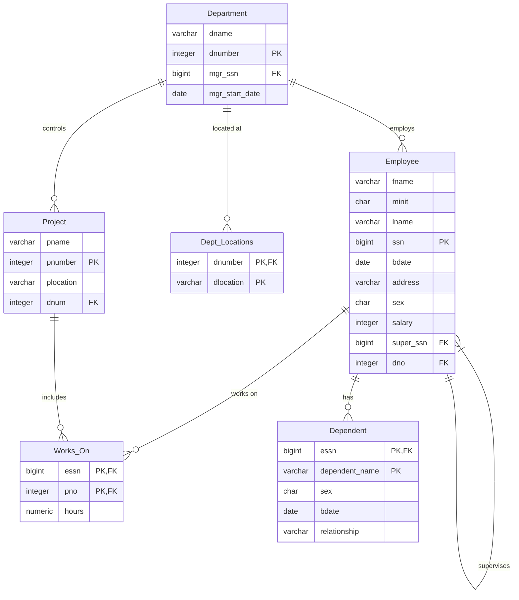

# COMPANY Database - Midsem Solution


## Overview

This project implements the COMPANY database schema with comprehensive integrity constraints and analytical queries. The solution covers table creation, foreign key relationships, data insertion, and complex SQL queries for employee, department, and project analysis.

## Database Schema

The COMPANY database consists of six relations modeling a typical organizational structure:



### Table Specifications

| Table | Primary Key | Foreign Keys | Description |
| :--- | :--- | :--- | :--- |
| **Employee** | `ssn` | `super_ssn`, `dno` | Employee personal and employment details |
| **Department** | `dnumber` | `mgr_ssn` | Department information and management |
| **Dept_Locations** | `dnumber`, `dlocation` | `dnumber` | Multiple locations per department |
| **Works_On** | `essn`, `pno` | `essn`, `pno` | Employee project assignments |
| **Project** | `pnumber` | `dnum` | Project details and controlling department |
| **Dependent** | `essn`, `dependent_name` | `essn` | Employee dependent information |

## Integrity Constraints

| Constraint Type | Field | Rule |
| :--- | :--- | :--- |
| **Primary Key** | All tables | Unique identification |
| **Foreign Key** | All relationships | Referential integrity with ON DELETE CASCADE/SET NULL |
| **Check** | `sex` | Values restricted to 'M', 'F', 'O' |
| **Check** | `salary` | Non-negative values |
| **Check** | `hours` | Between 0 and 100 |
| **Unique** | `email` | No duplicate employee emails |

## Queries Implemented

| # | Query | Technique |
| :--- | :--- | :--- |
| 1 | Create database with integrity constraints | DDL, CHECK, FOREIGN KEY |
| 2 | Departments with avg salary > 30000 | JOIN, GROUP BY, HAVING |
| 3 | Employees in dept with highest salary | Nested Subquery |
| 4 | Employees whose supervisor's supervisor = given SSN | Self JOIN (3 levels) |
| 5 | Employees making 10000+ more than minimum salary | Subquery, Arithmetic |
| 6 | View: Project statistics | CREATE VIEW, Aggregation |
| 7 | View: Department statistics | CREATE VIEW, Aggregation |

## Usage

### Prerequisites

- PostgreSQL 12 or higher
- `psql` command-line tool or GUI client (pgAdmin, DBeaver)

### Setup

```bash
# Create database
createdb company_db

# Run schema and data
psql -U your_username -d company_db -f schema.sql

# Run queries
psql -U your_username -d company_db -f queries.sql
```

### Verify Tables

```sql
\dt
```

### Sample Query

```sql
-- View project statistics
SELECT * FROM Project_Stats;
```

## File Structure

```text
Midsem-Solution/
├── README.md           # Documentation
├── schema.sql          # Table creation and constraints
├── data.sql            # Sample data insertion
└── queries.sql         # All 7 queries and views
```

## Technical Highlights

- Comprehensive foreign key relationships with cascading deletes
- Self-referential relationship for employee supervision hierarchy
- Composite primary keys for junction tables (Works_On, Dept_Locations, Dependent)
- View creation for reusable query logic
- Nested subqueries for complex analytical requirements
- Standard SQL JOIN syntax for clarity and maintainability

## Notes

- SSN values are 9-digit integers as per standard format
- Salary values are stored as integers (no decimal places)
- Hours worked on projects allow decimal values (NUMERIC type)
- NULL values permitted for supervisor SSN (top-level executives)